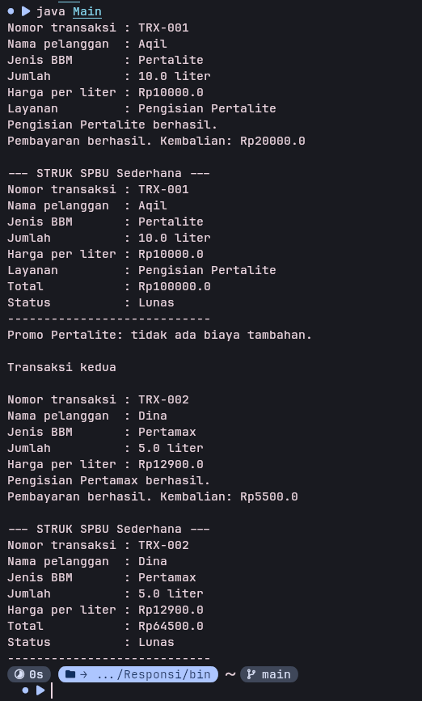

# Sistem Transaksi SPBU

## Identitas

- Nama: Aqil Fachri Al Habsy
- NIM: H1D025053
- Tema: SPBU (digit terakhir NIM 3)

## Compile dan jalankan

Dari folder proyek, jalankan perintah berikut di terminal:


- compail dulu semuanya
```bash
javac -d bin src/*.java
```
- lalu jalankan
```bash
java -cp bin Main
```
- atau masuk dulu ke direktory bin
```bash
java Main
```

Program menjalankan simulasi pengisian Pertalite dan Pertamax dengan data contoh.

## Konsep PBO pada program

- State dan behavior: atribut transaksi, prosedur `prosesPengisian()`, dan fungsi `hitungTotal()`.
- Immutability: konstanta `public static final` dan `nomorTransaksi` yang `private final`.
- Enkapsulasi dan overloading: atribut transaksi private dengan getter/setter; constructor tersedia dengan dan tanpa jumlah liter. Nomor transaksi hanya punya getter karena nilainya final.
- Inheritance: `PengisianPertalite` dan `PengisianPertamax` mewarisi abstract class `TransaksiSPBU`.
- Super chaining dan overriding: constructor subclass memanggil `super(...)`; `tampilkanDetail()` pada Pertalite memanggil `super.tampilkanDetail()`; method yang ditimpa memakai `@Override`.
- Abstract class dan percabangan: `prosesPengisian()` diimplementasikan masing-masing subclass dengan `if/else` yang mengubah status dan total transaksi.
- Polimorfisme interface: `Main` memakai variabel `OperasionalSPBU` untuk objek subclass; Pertalite juga mengimplementasikan `InfoPromo`.

## Screenshot luaran

Berikut screenshot luaran simulasi program:


